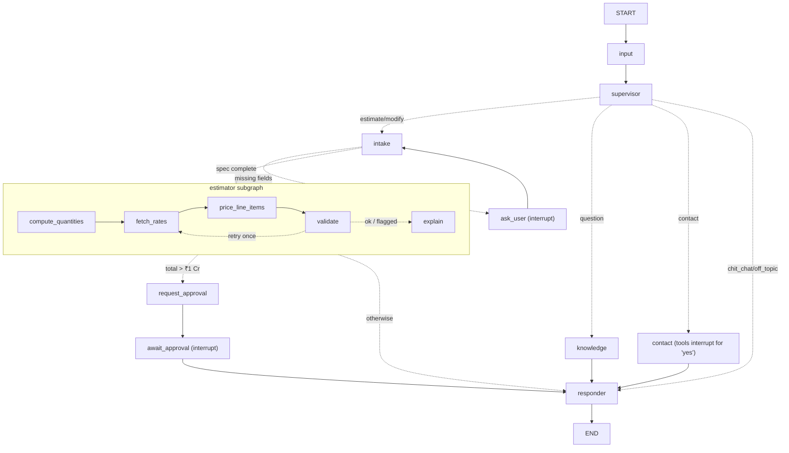

# Architecture

## Layers (dependencies point inward)

```
api/  (FastAPI routers, SSE, auth, rate limit)        ← transport
  └─ agent/runner.py  (thread protocol: run / resume / approve)
       └─ agent/graph.py + nodes + subgraph + tools    ← orchestration (LangGraph)
            ├─ services/   deterministic math, formatting, notifications
            ├─ domain/     Pydantic models (no I/O)
            └─ db/repositories (Protocols)  ← implemented by db/repositories/mongo.py
```

* **Composition root**: `api/container.py` builds every long-lived object once (Mongo client,
  model registry, repositories, checkpointer, compiled graph). Tests swap the whole container.
* **Runtime context vs state**: dependencies travel in `AgentContext` (never checkpointed);
  conversation data travels in `EstimatorState` (checkpointed per `thread_id`).

## Graph



Regenerate the exact diagram from code with `make graph` → `docs/graph.mmd`.

## Deviations from the PRD (and why)

| PRD | Here | Why |
|---|---|---|
| Supervisor → Estimator edge | Supervisor → Intake → Estimator | Intake is the *only* entry to pricing and checks `missing_fields()` in code. "modify" also needs extraction ("make it G+2"). |
| One owner-approval node | `request_approval` + `await_approval` | A node re-runs from the top on resume; side effects (DB write, email) must not sit in the interrupting node. |
| `create_react_agent` | `langchain.agents.create_agent` | LangChain v1 successor; same model↔ToolNode loop. |
| `rates` rows per item | one `RateCard` per (city, tier) | Shares, bands and extras validate together (shares sum to 1). |
| — | `approvals` collection | `/admin/pending` needs an index of paused threads; the checkpointer isn't queryable that way. |

## Guardrails (PRD §3, §11)

* Prices only from tools; the Explain LLM output is dropped if it contains any digit.
* The Responder writes prose; **code** appends the price table and the localized disclaimer.
* Structured output uses Gemini's native JSON-schema mode (schema enforced server-side).
* Checkpoint deserialization is allow-listed to domain types.
* `/chat` rate-limited per IP; admin endpoints need `X-Admin-Key` (constant-time compare).
